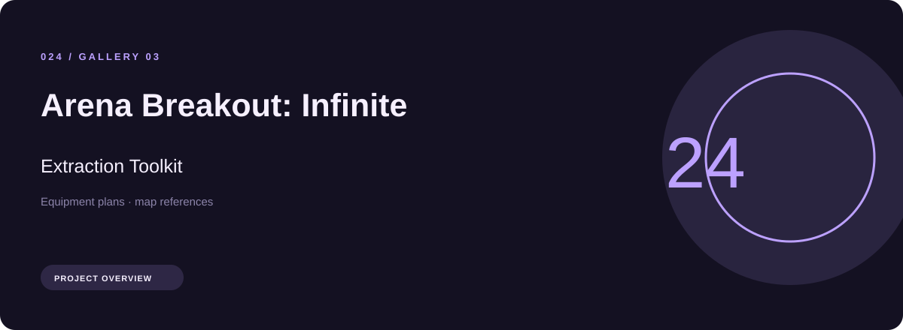
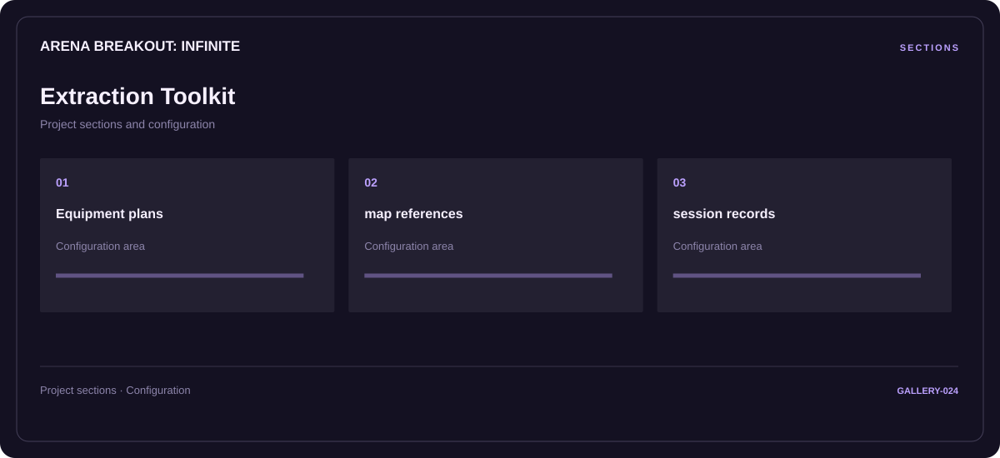

# 🛠️ Arena Breakout: Infinite Extraction Toolkit

**Equipment plans · Map references · Session records**

## ⚡ Features

A extraction toolkit workspace for Arena Breakout: Infinite, built around equipment plans and map references, with session records kept in a separate reference area.

### ⚙️ Equipment plans

Equipment categories and the associated selection or configuration options.

### 🧩 Map references

A dedicated section for map references and the configuration details associated with that area.

### ⌨️ Session records

Session and activity information grouped by the task or context it belongs to.

## 🖥️ Project navigation

## 📥 Download

The button and cover open the project's download page. Use the information supplied with the downloaded package for installation and release-specific requirements.

## 📚 Project documentation

- [Feature reference](docs/FEATURES.md)
- [Download information](docs/DOWNLOAD.md)
- [Project page](index.html)

---

Arena Breakout: Infinite Extraction Toolkit · Program documentation and download information.
